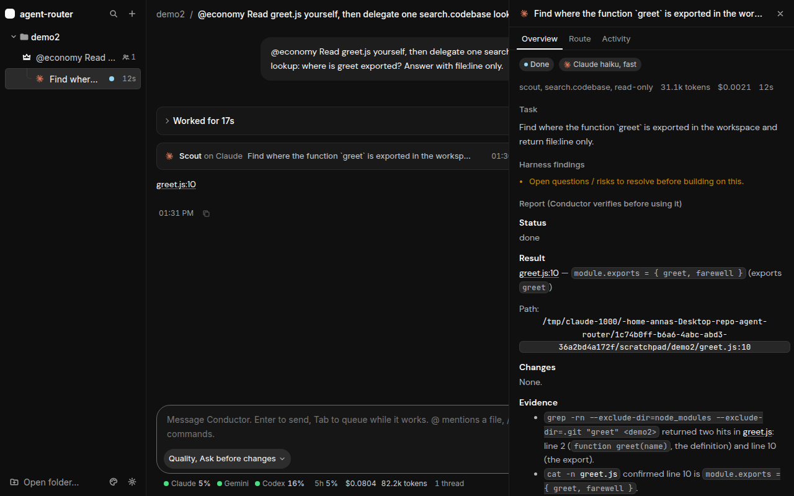
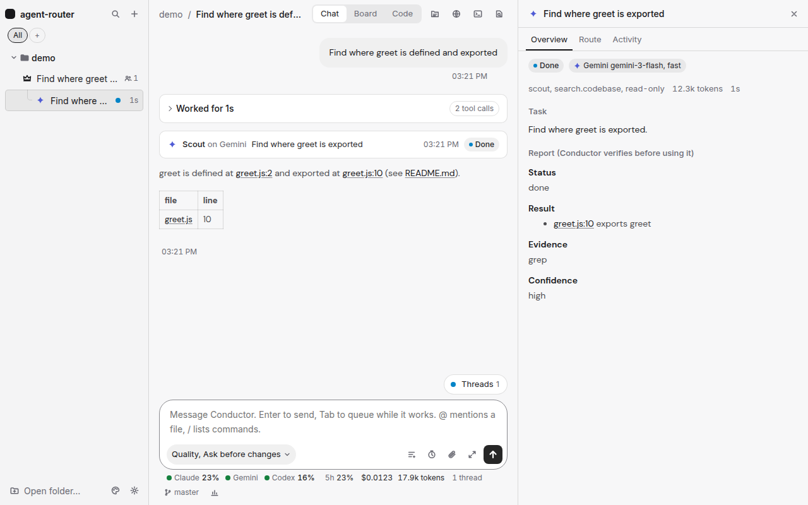
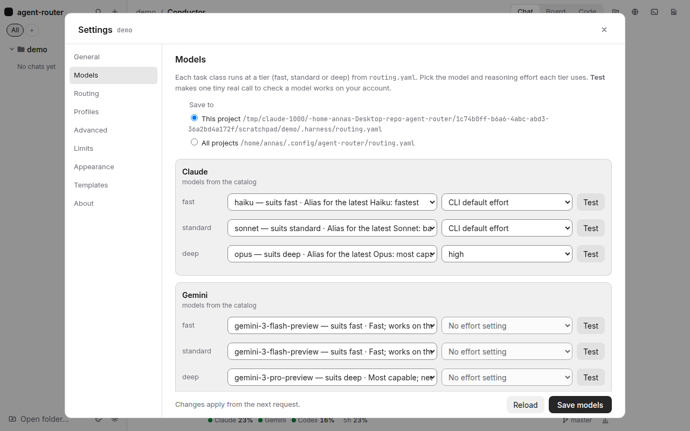

# agent-router

A harness that runs **Conductor** (`agent-harness-prompts/prompts/conductor.md`) on Claude Code and lets it delegate subtasks to Claude Code, Gemini CLI and Codex CLI, following the routing policy in `agent-harness-prompts/config/routing.yaml`.

```
agent-router "<request>"      ── headless Conductor (claude -p) ─┐
agent-router                  ── interactive Conductor (claude) ─┤
                                                                 │ MCP (stdio)
                         router MCP server: delegate · route · backends · check_diff · approve
                                                                 │
               decide() → backend adapter → escalation ladder → report checks
                     claude -p … stream-json │ gemini -p … json │ codex exec --json
```

## Use

```sh
npm install                       # installs bun locally too
npx bun run src/cli.ts doctor     # config, prompts, which CLIs are installed
npx bun run src/cli.ts "find where X is handled and explain it"
npx bun run src/cli.ts            # interactive Conductor session
npx bun run src/cli.ts route code.review --author claude    # dry-run a routing decision
npx bun run src/cli.ts delegate --class plan --task "…" --acceptance "…"   # one delegation, no Conductor
```

Options: `--permission default|acceptEdits|bypass`, `--workspace <dir>`, `--show-system-prompt`.
Keywords in a request:

| Keyword | Effect |
|---|---|
| `@claude`, `@gemini`, `@codex` | Pin that backend for the session. |
| `/route <class> <provider>` (own line) | Pin one task class, e.g. `/route code.review gemini`. |
| `@quality`, `@balanced`, `@economy` (or any profile you define) | Use that routing profile for this request; beats the Profile menu and `--profile`. |
| `ultrawork` or `ulw` | Quality profile, and Conductor is told to finish the whole task and verify it (build, tests, independent review) before answering. |

Keywords inside code blocks or inline code are ignored, so pasted code never changes routing.

Config is layered, later files winning key by key: the shipped `routing.yaml`, then your user file (`~/.config/agent-router/routing.yaml`; `%APPDATA%\agent-router\` on Windows, `~/Library/Application Support/agent-router/` on macOS), then `<workspace>/.harness/routing.yaml`.

## Desktop app (Tauri)



The layout follows [Ghostex](https://github.com/maddada/Ghostex) (MIT): the workspace and this chat's threads on the left, Conductor's conversation in the middle, the selected thread beside it. Every delegation is a **thread**: a row in the sidebar (backend, task, status, age), a line in the turn's **Threads** card (what it found or why it stopped), and on click a detail panel with its route, attempts, files changed, findings, report and live activity. Profile, plan and permission sit in the composer; spend, tokens and running threads in the line under it. Requests sent while Conductor works queue above the composer, and each backend in the sidebar shows how full its subscription window is. An edit thread's panel shows its exact diff, where you can comment on lines and send the comments back to that delegate, or revert the thread; a worktree thread's panel can preview, apply and remove its worktree. When Conductor needs a decision, it asks with a form in the chat. Light and dark follow the system.

| | |
|---|---|
|  |  |

The light-theme screenshot uses scripted sample data; the one above is a real run.

```sh
npm install                     # once
npm run desktop:dev             # dev: builds the UI, runs the core from src/ with the project's Bun
npm run desktop:build           # release: compiles the core into a sidecar and bundles the prompts
```

Needs Rust (rustup) and Tauri's system packages (on Ubuntu: `libwebkit2gtk-4.1-dev libxdo-dev libayatana-appindicator3-dev librsvg2-dev`; on Windows: WebView2, which ships with Windows 10/11).

The app starts `agent-router serve` on `127.0.0.1` with a random token and talks to it over WebSocket. Each request runs one headless Conductor turn (`claude -p --resume …`, so a chat continues across turns). The router's MCP child reports each delegation back to the app live, and sends permission prompts there, so **Allow / Deny** cards appear in the conversation. Closing the app closes the core's stdin, which cancels Conductor and every delegate.

## Permissions

| Harness mode | Conductor (claude) | Read-only delegates | Edit delegates |
|---|---|---|---|
| `default` | interactive and desktop: asks you; headless CLI: `approve` tool allows read-only delegation, refuses everything that writes | `dontAsk` + edit tools disallowed / codex read-only sandbox | asks (interactive) / refused (headless) |
| `acceptEdits` | edits accepted, shell refused when headless | same | `acceptEdits` / `workspace-write` / `auto_edit` |
| `bypass` | `bypassPermissions` | same | `bypassPermissions` / no sandbox / `yolo` |

## Models

Choose them in the desktop app under **Models**, which saves to this project or to all projects. **Test** next to each tier makes one tiny real call to check the model works on your account. Or edit `tiers` in a config file directly, with optional reasoning effort per tier (`reasoning`, used by Claude `--effort` and Codex `model_reasoning_effort`; Gemini has no such flag). The defaults were checked against the CLIs on 2026-10-28:

| Tier | Claude | Gemini | Codex |
|---|---|---|---|
| fast | haiku | gemini-3-flash-preview | gpt-6-luna, low |
| standard | sonnet | gemini-3-flash-preview | gpt-6-luna, medium |
| deep | opus, high | gemini-3-pro-preview (needs paid quota; otherwise falls back) | gpt-6-luna, xhigh |

**Model catalog and detection.** The model lists come from the CLI where it can list them, and from a catalog (`agent-harness-prompts/config/models.json`, shape adapted from Ghostex's) where it cannot:

| Backend | Where the list comes from |
|---|---|
| Codex | `codex debug models`: exactly what your account may use, with each model's efforts |
| Gemini | The Gemini API's model list when `GEMINI_API_KEY` or `GOOGLE_API_KEY` is set, plus the catalog; otherwise the catalog |
| Claude | The catalog (Claude Code has no list command; `haiku`, `sonnet`, `opus` and `fable` always mean the latest) |

`agent-router models` prints every list with the tier each model is set to and flags problems: a model your account does not offer, an effort the model does not accept, a tier left on the CLI default. `doctor` reports the same problems. The Models dialog says where each list came from and which tier the catalog suggests for each model.

Gemini only runs headless in folders it trusts. Trust the folder in Gemini once, or tick the trust checkbox under Gemini in **Models** (`trust_workspace: true`).

## Plans (your subscriptions)

Tell the router what you pay for, and the backend with more paid capacity does the frontier work. Choose a plan in the app's **Plan** menu, with `--plan <name>`, or with `plan:` in your config.

| Plan | Claude | ChatGPT (Codex) | Gemini | Effect |
|---|---|---|---|---|
| `claude-heavy` | tier 4, ~$466/mo | tier 1, $20 | 1000 req/day | Claude leads every Claude/Codex route (Codex tests too), Codex is fallback and second opinion |
| `chatgpt-heavy` | tier 1, $20 | tier 4, ~$477/mo | 1000 req/day | Codex leads plans, edits, tests and debugging; Claude is fallback and second opinion; Conductor runs on Sonnet, not Opus |
| `split` | tier 3.5, ~$255 | tier 3.5, ~$266 | 1000 req/day | Routing as shipped |

Tiers by monthly price: 1 = $20, 2 = $40, 3 = $200, 3.5 ≈ $255–266, 4 ≈ $466–477, and 0 = no subscription (that backend is never used). Custom: `plan: { claude: 2, openai: 3, gemini_requests_per_day: 1000 }`. A side leads when it pays at least 1.5× the other. The plan also sets how many delegates run at once on each backend ($20–40: 1, $200: 2, $400+: 3). Lookups stay on Gemini either way, and routes you set yourself win over the plan. Conductor itself always runs on Claude.


## Profiles

Choose one in the app's **Profile** menu, or with `--profile <name>` on the CLI. A profile only trades depth *above* each task class's quality floor: it can't lower `min_tier`, weaken privacy, or let an author review its own work. Anything you set yourself (Models dialog, user or project config) beats the profile.

| | Quality (default) | Balanced | Economy | Offload |
|---|---|---|---|---|
| Conductor | Opus | Sonnet, high effort | Sonnet | Sonnet, high effort |
| `plan` | deep | standard, deep when risky | standard | standard, deep when risky (Claude) |
| Who edits | Claude | Claude | Claude | Codex, Claude as fallback |
| Lookups when Gemini is out | Claude | Claude | Claude | Codex, then Claude |
| Independent review of edits | every edit | edits raised to deep (large or risky) | same as Balanced | same as Balanced |
| Second opinion on debug/architecture | yes | yes | no | yes |
| Codex effort at deep | xhigh | high | medium | high |
| Attempts per subtask | 4 | 4 | 3 | 4 |
| Extra Conductor rules | — | do small lookups itself, batch briefs, send excerpts not files, resume sessions | delegate only what needs another backend or a deep specialist | plan, brief and verify; no Edit or Write tool, so every change is delegated; verify from cited excerpts and tests |

Offload is for spreading work across subscriptions: Claude stays the architect (Conductor, plans, root-cause debugging and architecture on Opus), while Codex on your ChatGPT plan and Gemini do the reading and editing. A plan that makes Claude the frontier (`claude-heavy`) still puts Claude on edits.

"Risky" uses the same triggers as before: more than 5 files touched (10 in Economy), a previous failed attempt, or a task that mentions auth, security, payment, concurrency or migration. Define your own profiles under `profiles:` in your user or project config.

Measured on 2026-10-28 (3 small tasks × 2 runs each): every profile passed every task; Balanced cost 58% less than Quality and Economy 65% less, with weaker reviews on Economy. Against one CLI without the router, every profile used more tokens than Sonnet alone (Economy +28%) and Codex alone used the fewest. After the lean Claude tool set, Economy uses 25% fewer Claude tokens than Sonnet alone and costs $0.052 vs $0.068 per task on Claude. Details and how to re-run: [bench/RESULTS.md](bench/RESULTS.md).

## Delegate safeguards

- **Escalation ladder:** retry once with a sharper brief → one fallback provider → higher tier → any provider not yet tried at the top tier → ask the user, within `max_attempts_per_subtask`. Each rung is used once, so tier-up is reached however many providers are configured. A backend that is down (not installed, signed out, rate-limited, untrusted folder, context full) is skipped without a retry.
- **Watchdog:** a delegate that emits nothing for `limits.delegate_stall_seconds` (300), or repeats the same tool call `limits.max_identical_tool_calls` times in a row (12), is stopped and the ladder moves on. This replaces waiting out the 15-minute timeout.
- **Large reports:** a delegate report over 40,000 characters reaches Conductor as its head and tail. The full text is saved under `.harness/outputs/` (git-ignored) for Conductor to read in parts.
- **Directory rules:** besides the root `AGENTS.md`, each brief carries the `AGENTS.md` files in the folders of its relevant files, deepest last.
- **Report gate (Claude delegates):** a Stop hook keeps the delegate in its session until its final message is a well-formed report, so a formatting slip costs one more turn instead of a whole new attempt. It gives up after two blocks and leaves the rest to the ladder.
- **Project checks:** set `checks.commands` (e.g. `["npm run typecheck", "npm test"]`) in `.harness/routing.yaml`. They run after every edit-mode delegation, in the delegate's worktree if it had one, and failures reach Conductor as findings. They run only under "Accept edits" or "Bypass"; under "Ask before changes" Conductor is told to run them itself. Under "Accept edits", Claude edit delegates may also run exactly these commands themselves.
- **Background delegations:** Conductor can pass `background: true` to run independent subtasks at once, then collect them with `delegation_result` (`delegation_status` and `cancel_delegation` too). At most `limits.max_parallel_per_provider` (2) run on any one backend, so parallel work spreads instead of piling onto one rate limit. Unfinished jobs are cancelled when Conductor's turn ends.
- **Survives context compaction:** each chat keeps a delegation ledger. When Claude Code compacts Conductor's context, a SessionStart hook puts back what ran, which delegate sessions to resume, open worktrees and jobs still running.
- **No interactive prompts:** delegates, Conductor and project checks run with pagers, editors and credential prompts turned off (`GIT_PAGER=cat`, `GIT_EDITOR=:`, `GIT_TERMINAL_PROMPT=0`, `PIP_NO_INPUT`, …), so a command fails fast instead of waiting for input nobody can give.
- **Nudge before giving up:** the first time a Claude delegate stalls or loops, the harness resumes its own session with a note on what went wrong instead of starting over, so its work so far counts. Neither this nor the context restart below spends the last attempt, which stays for another backend. Codex delegates are resumed the same way (`codex exec resume`); Gemini delegates cannot be resumed yet and go straight to the ladder.
- **Context full mid-task:** a delegate that fills its context after doing some work gets one fresh session on the same backend, told which files it changed during the task. A brief too large to start with goes up the ladder as before.
- **Evidence files:** delegates that can write a file (any edit-mode delegate, and Claude delegates that run commands) save the output they cite under `.harness/evidence/` (git-ignored). A cited file that is missing, older than the task, empty, a symlink or outside that folder is a reject finding; citing none is a note for Conductor.
- **Rules from other tools:** besides `AGENTS.md`, briefs carry `.github/copilot-instructions.md`, `.github/instructions/*.instructions.md` (`applyTo`), `.cursor/rules/*.mdc` (`globs`, `alwaysApply`) and, for Gemini and Codex, `.claude/rules/*.md` (`paths`; Claude Code loads those itself), each only for the files it targets.
- **Code navigation:** when a language server is installed, Claude and Codex delegates get `diagnostics`, `definition`, `references` and `symbols` tools from `agent-router lsp-mcp`. TypeScript 7 projects use TypeScript's own `tsc --lsp`; older ones `typescript-language-server`; also pyright or pylsp, gopls, rust-analyzer and clangd.
- **Comments that narrate the change** ("Added null check", "as requested") are flagged by `check_diff` for a look.
- **Desktop notifications** when a turn finishes or an approval is waiting while the app is in the background.
- **Lean Claude tool set:** Conductor loads only Read, Edit, Write and Bash (plus the router's MCP tools), and Claude delegates only what their mode uses. Claude Code's other built-in tool definitions cost about 14k prompt tokens on every request. Set `lean_tools: false` under `backends.claude` to load them all.
- **Codex sessions resume:** a follow-up passed with `resume` continues the Codex thread, so it keeps what it already read. Codex reports a resumed thread's running total, so the harness subtracts the earlier total (kept in the chat ledger) and counts only the new tokens.
- **Token budget per delegation:** `budget.delegate_tokens` stops the escalation ladder once a subtask has spent that many tokens, instead of paying for a higher tier.
- **Changed files in every edit result:** the result Conductor gets lists the files the delegate changed with `+added -removed` counts (from git, not from the delegate's report), so it verifies the diff without re-reading whole files. The thread's detail panel in the desktop app shows them too.
- **Pane telemetry:** `telemetry.events_file` writes a JSON-lines stream (`dispatch`, `update`, `merge`, `halt`) with each delegation's provider, model, worktree, files and token/cost, for UIs that show agents as panes (Ghostex and the like). The desktop app shows the same as threads in its sidebar. See [Configuration](docs/configuration.md#telemetry).
- **Honest token counts:** output includes thinking tokens (Gemini reports them apart from `output_tokens`, but bills them as output), and delegation results and telemetry say how much of the input was a prompt-cache read. A delegate re-sends its whole conversation on every tool call, so a long lookup's input total is mostly cache reads.
- **Leaner delegate prompts:** delegates get the report half of the delegation protocol, not the brief-writing rules meant for Conductor (about 400 tokens less on every turn of every delegate). Scout has a tool-call budget: 2–6 calls for a typical lookup, report as soon as every acceptance item has a location.
- **Token economy rules:** Conductor's prompt (§8) tells it to handle small tasks itself, scout before briefing an expensive agent, pass `path:start-end` references instead of whole files, keep handoffs short, resume sessions and verify from the changed-file list. Scout's report is capped at about 20 locations.
- **Live quota:** Claude Code reports its 5-hour and weekly usage in its stream, and Codex records its windows in each thread's rollout file. The router keeps the latest per account (`~/.cache/agent-router/quota.json`, shared by every process). A backend whose window is full is skipped until the window resets, and one past `limits.quota_avoid_at` (90%) goes to the back of the line unless you pinned it. A rate limit with a known reset time no longer takes the backend out for the whole session. The desktop sidebar shows each backend's fullest window, with every window in the tooltip.
- **Worktree setup:** `worktrees.setup` commands (e.g. `["npm ci"]`) run in each new delegate worktree before the delegate starts, with `AGENT_ROUTER_WORKSPACE` pointing at the main checkout so a script can copy `.env` or link caches. A failed step is a finding; the delegate still runs.
- **Project memory:** `.harness/memory.md` holds lasting facts and standing rules ("tests need `make test-local`", "never edit billing/"), one per line. Conductor's prompt and every brief carry them, so they survive compaction and new chats. Conductor adds a note with its `remember` tool when you state a lasting rule or it verifies a fact worth keeping (and tells you), removes one with `forget`, and you can edit the file by hand. At most 60 notes of 600 characters.
- **Prompt queue:** in the desktop app, a request sent while Conductor works waits in a queue above the composer and starts when the turn ends. You can move one to the front or drop it. Stop pauses the queue rather than letting the next request start; sending or **Resume** carries on. The queue is in memory only, so nothing is ever re-sent after a crash.
- **Checkpoints and Revert:** before and after every edit delegation the harness snapshots the checkout into a hidden commit (`refs/agent-router/checkpoints/…`, built with a throwaway index, so your branch, index and files are untouched; the newest 200 are kept). Only one delegate writes in a checkout at a time, so the diff between a thread's two snapshots is exactly what that thread changed. The thread panel shows it, and **Revert thread** undoes it by applying it in reverse, all or nothing: if a file has changed since, nothing is touched and you are told why. Conductor hears about a revert at the start of its next turn.
- **Review comments on a thread's diff:** click a line in the thread's diff (shift-click for a range), write a comment, add more, then **Send to Conductor**. They go as a request with each comment's file and lines and the delegate's session, so Conductor resumes that same delegate (Claude or Codex) to fix its own change, then verifies it as usual. It queues if a turn is running.
- **Bringing a worktree in:** a parallel writer's worktree holds uncommitted changes, so the router snapshots it and offers three steps, as router tools for Conductor and as buttons in the thread panel. **Preview** lists the files it changed, the files that conflict with the workspace's HEAD (`git merge-tree`, nothing touched) and whether the changes apply cleanly to the workspace as it is now, your uncommitted edits included. **Apply** brings them in as uncommitted changes, all or nothing, so you still decide what to commit. **Remove** deletes the worktree, refusing while its changes are not in the workspace unless you choose to discard them, and keeps its branch if it has commits the workspace lacks. Under "Accept edits", Apply and a plain Remove need no approval.
- **Question forms:** Conductor runs headless and cannot ask interactively, so when it needs you to decide it ends its turn with a `questions` block (choices with its recommendation marked, several picks, or free text; format from Ghostex). The desktop app shows a form; every question also takes your own answer or a skip, and the answers go back as the next request. In a terminal the block shows as JSON.
- **Read-only Claude delegates can search:** Claude Code 2.1.312 has no Grep/Glob tools, so read-only delegates may run `grep`, `ls`, `cat`, `head`, `tail` and `wc`, and nothing else (no `rg --pre`, `git`, `find`, or redirection). No delegate may start subagents.

The watchdog, output cap, directory rules, report gate, background delegations, keyword modes, compaction recovery, project checks, non-interactive environment, nudges, context restarts, evidence files, rule files, code navigation, comment checks and notifications follow ideas from oh-my-openagent. They were reimplemented here, not copied: most of that project is under a non-open-source license, and its MIT LSP package depends on parts that are not MIT. One idea did not carry over: hints after a failed edit. Claude Code 2.1.312 rejects a bad Edit before any hook runs, so no hook can see it.

## Documentation

- [Architecture](docs/architecture.md): components, the life of a request, the escalation ladder, permissions, hooks, the desktop protocol.
- [Configuration](docs/configuration.md): every `routing.yaml` key, profiles and request keywords.
- [Development](docs/development.md): layout, tests, extending the harness, behaviour of the wrapped CLIs.
- [Token and cost efficiency](docs/token-efficiency.md): where tokens go, every saving mechanism, how to measure and tune it, and a case study.
- [Benchmark results](bench/RESULTS.md).

## Status

Verified on Linux (Ubuntu 26.04) with Claude Code 2.1.312, Gemini CLI 0.66.0 and Codex CLI 0.165.0: unit and contract tests (adapter fixtures are recorded from those versions), `doctor`, real delegations on all three backends, a full Conductor → router → delegate run, and the desktop app end to end (delegation cards, an approval prompt answered in the app, cancel).
Not yet verified: Windows (CI is set up for `windows-latest`) and macOS. Conductor itself runs only on Claude for now. Not built: the Ink TUI.
