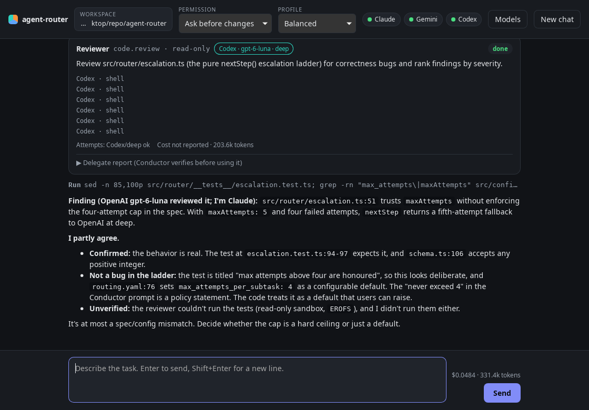
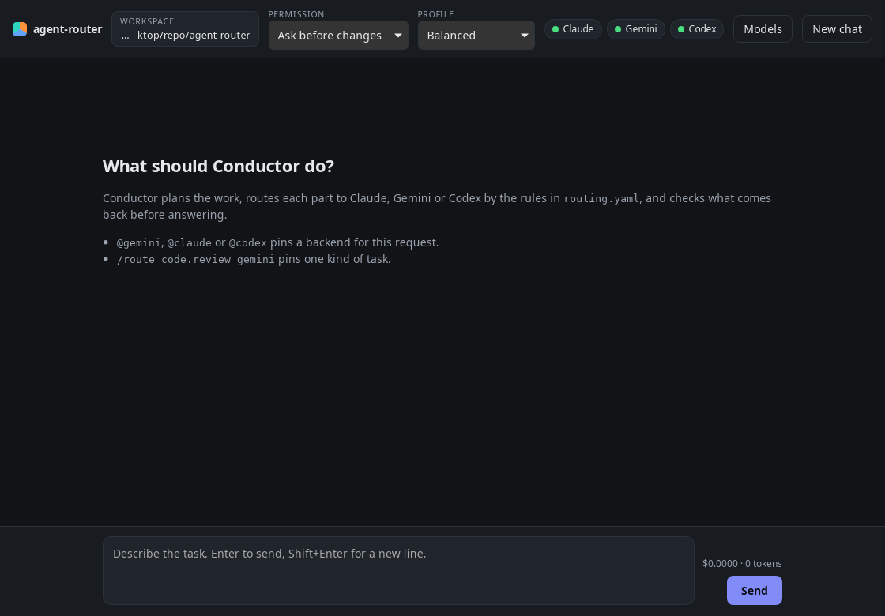
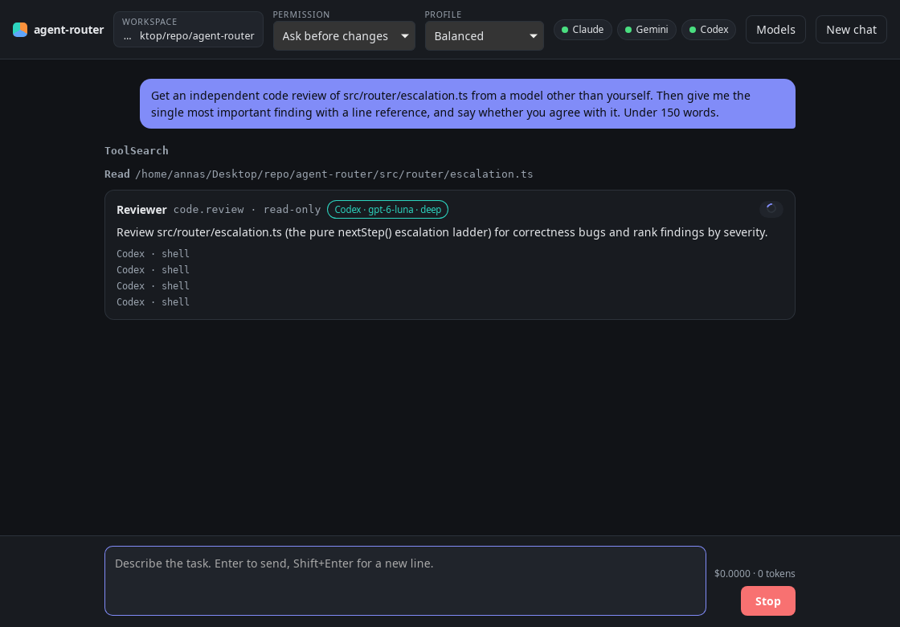
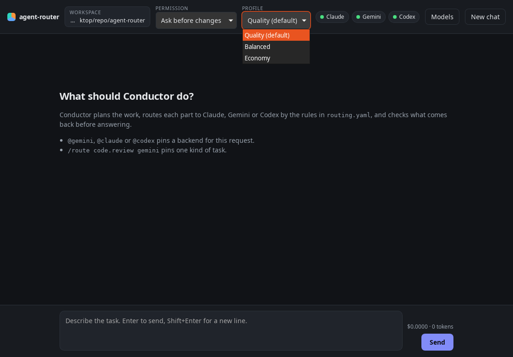
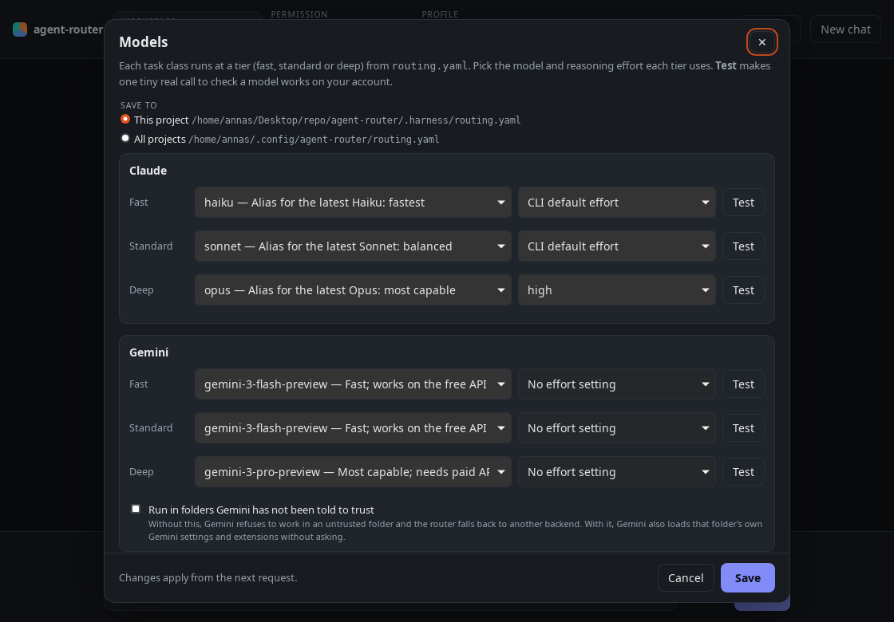
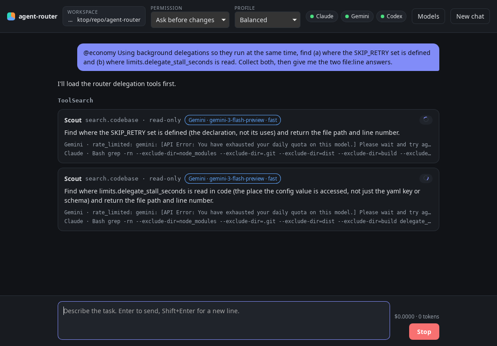

# agent-router

A harness that runs **Conductor** (`agent-harness-prompts/prompts/conductor.md`) on Claude Code and lets it delegate subtasks to Claude Code, Gemini CLI and Codex CLI, following the routing policy in `agent-harness-prompts/config/routing.yaml`.

```
agent-router "<request>"      ── headless Conductor (claude -p) ─┐
agent-router                  ── interactive Conductor (claude) ─┤
                                                                 │ MCP (stdio)
                         router MCP server: delegate · route · backends · check_diff · approve
                                                                 │
               decide() → backend adapter → escalation ladder → report checks
                     claude -p … stream-json │ gemini -p … json │ codex exec --json
```

## Use

```sh
npm install                       # installs bun locally too
npx bun run src/cli.ts doctor     # config, prompts, which CLIs are installed
npx bun run src/cli.ts "find where X is handled and explain it"
npx bun run src/cli.ts            # interactive Conductor session
npx bun run src/cli.ts route code.review --author claude    # dry-run a routing decision
npx bun run src/cli.ts delegate --class plan --task "…" --acceptance "…"   # one delegation, no Conductor
```

Options: `--permission default|acceptEdits|bypass`, `--workspace <dir>`, `--show-system-prompt`.
Keywords in a request:

| Keyword | Effect |
|---|---|
| `@claude`, `@gemini`, `@codex` | Pin that backend for the session. |
| `/route <class> <provider>` (own line) | Pin one task class, e.g. `/route code.review gemini`. |
| `@quality`, `@balanced`, `@economy` (or any profile you define) | Use that routing profile for this request; beats the Profile menu and `--profile`. |
| `ultrawork` or `ulw` | Quality profile, and Conductor is told to finish the whole task and verify it (build, tests, independent review) before answering. |

Keywords inside code blocks or inline code are ignored, so pasted code never changes routing.

Config is layered, later files winning key by key: the shipped `routing.yaml`, then your user file (`~/.config/agent-router/routing.yaml`; `%APPDATA%\agent-router\` on Windows, `~/Library/Application Support/agent-router/` on macOS), then `<workspace>/.harness/routing.yaml`.

## Desktop app (Tauri)



| | |
|---|---|
|  |  |
|  |  |

```sh
npm install                     # once
npm run desktop:dev             # dev: builds the UI, runs the core from src/ with the project's Bun
npm run desktop:build           # release: compiles the core into a sidecar and bundles the prompts
```

Needs Rust (rustup) and Tauri's system packages (on Ubuntu: `libwebkit2gtk-4.1-dev libxdo-dev libayatana-appindicator3-dev librsvg2-dev`; on Windows: WebView2, which ships with Windows 10/11).

The app starts `agent-router serve` on `127.0.0.1` with a random token and talks to it over WebSocket. Each request runs one headless Conductor turn (`claude -p --resume …`, so a chat continues across turns). The router's MCP child reports each delegation back to the app live, and sends permission prompts there, so **Allow / Deny** cards appear in the conversation. Closing the app closes the core's stdin, which cancels Conductor and every delegate.

## Permissions

| Harness mode | Conductor (claude) | Read-only delegates | Edit delegates |
|---|---|---|---|
| `default` | interactive and desktop: asks you; headless CLI: `approve` tool allows read-only delegation, refuses everything that writes | `dontAsk` + edit tools disallowed / codex read-only sandbox | asks (interactive) / refused (headless) |
| `acceptEdits` | edits accepted, shell refused when headless | same | `acceptEdits` / `workspace-write` / `auto_edit` |
| `bypass` | `bypassPermissions` | same | `bypassPermissions` / no sandbox / `yolo` |

## Models

Choose them in the desktop app under **Models**, which saves to this project or to all projects. **Test** next to each tier makes one tiny real call to check the model works on your account. Or edit `tiers` in a config file directly, with optional reasoning effort per tier (`reasoning`, used by Claude `--effort` and Codex `model_reasoning_effort`; Gemini has no such flag). The defaults were checked against the CLIs on 2026-10-28:

| Tier | Claude | Gemini | Codex |
|---|---|---|---|
| fast | haiku | gemini-3-flash-preview | gpt-6-luna, low |
| standard | sonnet | gemini-3-flash-preview | gpt-6-luna, medium |
| deep | opus, high | gemini-3-pro-preview (needs paid quota; otherwise falls back) | gpt-6-luna, xhigh |

Gemini only runs headless in folders it trusts. Trust the folder in Gemini once, or tick the trust checkbox under Gemini in **Models** (`trust_workspace: true`).

## Profiles

Choose one in the app's **Profile** menu, or with `--profile <name>` on the CLI. A profile only trades depth *above* each task class's quality floor: it can't lower `min_tier`, weaken privacy, or let an author review its own work. Anything you set yourself (Models dialog, user or project config) beats the profile.

| | Quality (default) | Balanced | Economy |
|---|---|---|---|
| Conductor | Opus | Sonnet, high effort | Sonnet |
| `plan` | deep | standard, deep when risky | standard |
| Independent review of edits | every edit | edits raised to deep (large or risky) | same as Balanced |
| Second opinion on debug/architecture | yes | yes | no |
| Codex effort at deep | xhigh | high | medium |
| Attempts per subtask | 4 | 4 | 3 |
| Extra Conductor rules | — | do small lookups itself, batch briefs, send excerpts not files, resume sessions | delegate only what needs another backend or a deep specialist |

"Risky" uses the same triggers as before: more than 5 files touched (10 in Economy), a previous failed attempt, or a task that mentions auth, security, payment, concurrency or migration. Define your own profiles under `profiles:` in your user or project config.

Measured on 2026-10-28 (3 small tasks × 2 runs each): every profile passed every task; Balanced cost 58% less than Quality and Economy 65% less, with weaker reviews on Economy. Details and how to re-run: [bench/RESULTS.md](bench/RESULTS.md).

## Delegate safeguards

- **Escalation ladder:** retry once with a sharper brief → one fallback provider → higher tier → any provider not yet tried at the top tier → ask the user, within `max_attempts_per_subtask`. Each rung is used once, so tier-up is reached however many providers are configured. A backend that is down (not installed, signed out, rate-limited, untrusted folder, context full) is skipped without a retry.
- **Watchdog:** a delegate that emits nothing for `limits.delegate_stall_seconds` (300), or repeats the same tool call `limits.max_identical_tool_calls` times in a row (12), is stopped and the ladder moves on. This replaces waiting out the 15-minute timeout.
- **Large reports:** a delegate report over 40,000 characters reaches Conductor as its head and tail. The full text is saved under `.harness/outputs/` (git-ignored) for Conductor to read in parts.
- **Directory rules:** besides the root `AGENTS.md`, each brief carries the `AGENTS.md` files in the folders of its relevant files, deepest last.
- **Report gate (Claude delegates):** a Stop hook keeps the delegate in its session until its final message is a well-formed report, so a formatting slip costs one more turn instead of a whole new attempt. It gives up after two blocks and leaves the rest to the ladder.
- **Project checks:** set `checks.commands` (e.g. `["npm run typecheck", "npm test"]`) in `.harness/routing.yaml`. They run after every edit-mode delegation, in the delegate's worktree if it had one, and failures reach Conductor as findings. They run only under "Accept edits" or "Bypass"; under "Ask before changes" Conductor is told to run them itself. Under "Accept edits", Claude edit delegates may also run exactly these commands themselves.
- **Background delegations:** Conductor can pass `background: true` to run independent subtasks at once, then collect them with `delegation_result` (`delegation_status` and `cancel_delegation` too). At most `limits.max_parallel_per_provider` (2) run on any one backend, so parallel work spreads instead of piling onto one rate limit. Unfinished jobs are cancelled when Conductor's turn ends.
- **Survives context compaction:** each chat keeps a delegation ledger. When Claude Code compacts Conductor's context, a SessionStart hook puts back what ran, which delegate sessions to resume, open worktrees and jobs still running.
- **Read-only Claude delegates can search:** Claude Code 2.1.312 has no Grep/Glob tools, so read-only delegates may run `grep`, `ls`, `cat`, `head`, `tail` and `wc`, and nothing else (no `rg --pre`, `git`, `find`, or redirection). No delegate may start subagents.



The watchdog, output cap, directory rules, report gate, background delegations, keyword modes, compaction recovery and project checks follow ideas from oh-my-openagent. They were reimplemented here, not copied, because most of that project is under a non-open-source license. Its LSP diagnostics were not ported as such: project checks give a language-neutral equivalent without a language-server runtime.

## Documentation

- [Architecture](docs/architecture.md): components, the life of a request, the escalation ladder, permissions, hooks, the desktop protocol.
- [Configuration](docs/configuration.md): every `routing.yaml` key, profiles and request keywords.
- [Development](docs/development.md): layout, tests, extending the harness, behaviour of the wrapped CLIs.
- [Benchmark results](bench/RESULTS.md).

## Status

Verified on Linux (Ubuntu 26.04) with Claude Code 2.1.312, Gemini CLI 0.66.0 and Codex CLI 0.165.0: unit and contract tests (adapter fixtures are recorded from those versions), `doctor`, real delegations on all three backends, a full Conductor → router → delegate run, and the desktop app end to end (delegation cards, an approval prompt answered in the app, cancel).
Not yet verified: Windows (CI is set up for `windows-latest`) and macOS. Conductor itself runs only on Claude for now. Not built: the Ink TUI.
